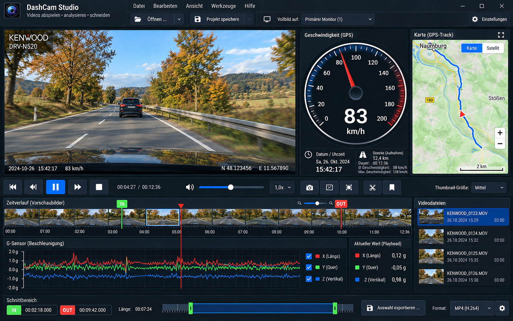

# DashCam Studio — erster funktionaler Stand

> **KI-generiertes Projekt / AI-generated project:** Der bisherige Quellcode, die Tests und die Dokumentation wurden mit OpenAI Codex auf Basis menschlicher Vorgaben erstellt. Die Entwicklung wird vom Projektinhaber gesteuert. Automatisierte Tests ersetzen keine vollständige menschliche Prüfung. Künftige KI-generierte oder KI-unterstützte Änderungen werden entsprechend gekennzeichnet.

Linux-Desktopanwendung zum Sichten und Schneiden normaler Videos. Python 3.11+, PySide6/Qt Multimedia, FFmpeg und ffprobe. Keine Kenwood-Dateien oder Telemetrie erforderlich. Das frühere Designbild war im Gesprächsabruf nicht verfügbar; das dunkle Layout folgt der beschriebenen Anordnung.

## Entwicklungsziel: modulare Kameraunterstützung

Weitere Dashcam-Hersteller und -Modelle sollen schrittweise **modular ergänzt** werden können. Geplant sind austauschbare Kameraadapter für Dateierkennung, Aufnahmezuordnung sowie das Auslesen und Normalisieren modellspezifischer Metadaten und Telemetrie (z. B. GPS, Geschwindigkeit und G-Sensor). Player, Projektverwaltung und Darstellung sollen unabhängig vom jeweiligen Kameramodell bleiben.

Normale Videos und Kameras ohne unterstützte Telemetrie sollen weiterhin abspielbar sein; fehlende Daten werden ausdrücklich als „keine Daten“ angezeigt. Neue Adapter sollen anhand geeigneter Beispieldateien separat getestet werden. Kenwood DRV-N520 ist ein erster geplanter Kandidat, keine Beschränkung auf einen Hersteller. Ein erster Kenwood-Adapter ist verfügbar; eine allgemeine Adapterschnittstelle für weitere Modelle ist geplant.

## UI-Zielbild

Das folgende **KI-generierte Zielbild** dient als visuelle Orientierung für die weitere Entwicklung. Es ist ein Designentwurf und zeigt nicht den aktuellen Funktionsstand. Karte, GPS-Geschwindigkeit und G-Sensorwerte sind illustrative Beispieldaten; ihre Darstellung bedeutet keine bereits implementierte Telemetrieunterstützung.



## Start auf CachyOS / Arch

FFmpeg und ffprobe müssen im PATH liegen. Falls sie fehlen, nach eigener Prüfung über die Arch-Paketverwaltung installieren (`sudo pacman -S ffmpeg python`). Das Projekt installiert selbst keine Systempakete.

Im Projektordner starten:

```sh
bash ./start.sh
```

Beim ersten Start legt das Skript die lokale Python-Umgebung an und lädt PySide6, falls es fehlt. Optional lässt sich mit `bash ./install-starter.sh` der Eintrag **DashCam Studio** im Anwendungsmenü des aktuellen Benutzers anlegen. Nach einem Umzug des Projektordners das Installationsskript im neuen Ordner erneut ausführen.

Manuell lässt sich die Anwendung ebenfalls starten:

Im Verzeichnis dieser README:

```sh
python -m venv .venv
.venv/bin/python -m pip install -e .
.venv/bin/python -m dashcam_studio
```

In der gelieferten Arbeitskopie ist `.venv` mit PySide6 6.12.0 bereits eingerichtet; dort genügt die letzte Zeile. Virtuelle Umgebungen sind nicht portabel, auf einem anderen Rechner neu anlegen. Optional nach Installation: `.venv/bin/dashcam-studio`.

Qt verwendet seine eigene Multimedia-Anbindung; ffmpeg/ffprobe im PATH übernehmen Analyse, Vorschaubilder, Proxy und Export. Bei Wayland-/Treiberproblemen kann zum Vergleich `QT_QPA_PLATFORM=xcb .venv/bin/python -m dashcam_studio` helfen. Dafür muss eine funktionierende X11/XWayland-Umgebung vorhanden sein.

## Bedienung

1. **Neues Projekt**: einen leeren, beschreibbaren Ordner wählen. Oder vorhandenen Projektordner öffnen.
2. **Importieren**: Video auswählen. „Ins Projekt kopieren“ ist standardmäßig aktiv und für SD-Karten empfohlen. Ohne Haken wird nur der absolute Dateipfad referenziert; die Karte muss dann für Wiedergabe/Export verfügbar bleiben.
3. Medium links auswählen. Die zwölf Vorschaubilder werden im Hintergrund erstellt. Jedes Bild zeigt den Beginn seines Zeitabschnitts; die Zeit steht darunter. Ein gelber Abspielkopf läuft synchron mit der Wiedergabeposition, der aktuelle Abschnitt ist blau umrahmt. Klicken oder Ziehen im Filmstreifen sucht die exakte Zeit an dieser Stelle; die Bilder sind feste Übersichten und keine laufenden Mini-Videos. Große Dateien werden zunächst vollständig gehasht; das kann dauern.
4. Leertaste startet/pausiert, Pfeiltasten springen ±5 Sekunden. Slider und Filmstreifen erlauben direktes Suchen. Stop setzt die Wiedergabe zurück. Lautstärke steht rechts.
5. **I / O** setzen IN/OUT in Millisekunden. Die Marker werden sofort gespeichert. Export lehnt umgekehrte/leere Bereiche ab. Marker definieren einen Ausschnitt pro Medium, keine Mehrspurmontage.
6. **Export IN–OUT** schreibt eine neue MP4-Datei (H.264/AAC). Das Original wird verwendet, auch wenn ein Proxy abgespielt wird. Es wird neu kodiert; vorhandene Ziele werden niemals überschrieben. Genauigkeit ist durch Video-/Audio-Zeitbasis und Bildrate begrenzt.
7. **Proxy erstellen / nutzen** erzeugt einen H.264-Proxy mit maximal 1280 Pixeln Breite und schaltet zur Wiedergabe darauf um. Erneute Auswahl in der Medienliste verwendet wieder das Original. Proxys sind optional und werden erst auf Anforderung gebaut.
8. Monitor auswählen und **Vollbild** / F11 drücken. Esc oder F11 beendet Vollbild; Leertaste funktioniert auch dort. Es wird nur das Video auf den gewählten Monitor gelegt.
9. Offline-Medien sind markiert. Auswählen und **Relink** mit einer identischen Datei: externe Referenzen werden aktualisiert; fehlende verwaltete Medien werden zurückkopiert. SHA-256 schützt vor versehentlichem Verbinden einer anderen Aufnahme.

Die Anwendung öffnet Quellen ausschließlich zum Lesen; sie verschiebt oder löscht keine Originaldateien. Es werden keine Schreibschutzattribute auf der SD-Karte verändert. Für zusätzlichen Schutz kann die Karte außerhalb der Anwendung nur lesend eingebunden werden. Importierte Kopien werden überprüft. Platzmangel und ffmpeg-Fehler werden angezeigt. Mehrfachimport derselben Aufnahme ist erlaubt.

## Projektformat und Architektur

```text
Projekt/
  project.json           # Version, Medien-IDs, Pfade, SHA-256, Dauer, IN/OUT
  .studio.lock           # Linux flock gegen parallele GUI-Schreiber
  media/<UUID>.<ext>     # verwaltete Originalkopien, relative Projektpfade
  metadata/<UUID>.json   # vollständige ffprobe-Ausgabe + duration_ms
  cache/<SHA256>/        # zwölf JPEGs + optional proxy.mp4
  exports/               # vorgeschlagenes Exportziel
  telemetry/             # NMEA-Rohdaten und normalisierte Telemetrie
```

`core.py` enthält das Qt-unabhängige Modell und FFmpeg-Dienste, `app.py` die Oberfläche. Ein serieller Worker hält Hashing, Import, Vorschauerzeugung und Export vom GUI-Thread fern. Währenddessen sind Projektwechsel und weitere Medienaufträge gesperrt. Schließen wartet auf das Ende des laufenden Vorgangs; ein Abbrechen-Button ist noch nicht vorhanden.

Projekt und Metadaten werden über temporäre Dateien plus atomarem Austausch geschrieben. Cache-Dateien werden erst nach erfolgreicher Erstellung veröffentlicht; Exporte werden atomar und ohne Überschreiben angelegt. Cache-Schlüssel enthalten den vollständigen Medienhash und die Version der Erzeugungsparameter. Beim Öffnen eines Mediums bzw. vor Proxy/Export wird der Hash erneut geprüft. Bei verändertem Inhalt werden Metadaten aktualisiert und Marker auf das vollständige Video zurückgesetzt. Alte Cache-Generationen bleiben zur sicheren manuellen Bereinigung liegen. Den kompletten `cache/`-Ordner kann man bei geschlossener Anwendung löschen; er wird neu aufgebaut. `media/`, `metadata/` und `project.json` sind keine Caches.

Verwaltete Projekte können als kompletter Ordner verschoben werden. Externe Referenzen sind absolute Pfade und benötigen danach ggf. Relinking. Schema 1 wird geprüft; unbekannte Versionen werden abgelehnt. Die GUI sperrt das geöffnete Projekt unter Linux gegen eine zweite GUI-Instanz; direkte Bibliotheksaufrufe müssen selbst serialisiert werden. Projektdateien sind lokale Arbeitsdateien, kein Format für beliebige untrusted Downloads. Es gibt noch keine schemaübergreifenden Migrationen, Undo-Historie, Backup-Versionen oder Wiederherstellung verwaister Importkopien nach einem Rechnerabsturz. Für Archivierung den gesamten Projektordner sichern.

Ohne passende Messwerte zeigen Geschwindigkeit und G-Sensor ausdrücklich **keine Daten**. `telemetry: null` je Medium und der Telemetrieordner sind Erweiterungspunkte. Der erste Kenwood-Adapter verarbeitet passende NMEA-Begleitdateien (siehe SD-Import unten). Es werden keine Telemetriewerte erfunden.

## Tests und Demo

```sh
QT_QPA_PLATFORM=offscreen .venv/bin/python -m unittest discover -s tests -v
```

Die Tests erzeugen normale Videos lokal mit FFmpeg und prüfen Importkopie/Originalschutz, Persistenz, Thumbnail- und Proxyerzeugung, Exportdauer, Überschreibschutz, Offline/Relink, Cache-Invalidierung, Pfadschutz und den GUI-Fensterstart.

Ein erzeugtes Testvideo liegt unter `demo/testvideo.mp4`. Es enthält ausschließlich ein synthetisches Testmuster, keine Kamera- oder personenbezogenen Daten. Für eine eigene längere Datei:

```sh
ffmpeg -f lavfi -i testsrc2=size=1280x720:rate=25 -t 15 -c:v libx264 testvideo.mp4
```

Automatisiert verifiziert: FFmpeg-Integration und Qt-Fensterstart ohne Bildschirm. Ein interaktiver Test von Ton, Treibern, Wayland/X11 und echtem Mehrmonitor-Vollbild auf dem Zielrechner steht noch aus. Streaming, Live-Erkennung entfernter Datenträger, Frame-Step, mehrere gleichzeitige Kameras und Batch-Export sind noch nicht enthalten.

## Auf einem anderen Rechner weiterarbeiten

Repository klonen und im geklonten Ordner die Umgebung neu einrichten:

```sh
git clone https://github.com/jps79/dashcam-studio.git
cd dashcam-studio
python -m venv .venv
.venv/bin/python -m pip install -e .
.venv/bin/python -m dashcam_studio
```

Für ein privates Repository muss GitHub-Zugriff eingerichtet sein. FFmpeg und ffprobe müssen zusätzlich installiert sein. Die virtuelle Umgebung wird auf jedem Rechner neu erstellt.

Entwicklungsstand und nächste Schritte stehen in `DEVELOPMENT.md`. Die synthetischen Demo-Videos sind enthalten. Eigene Aufnahmeprojekte bleiben außerhalb des Quellcode-Repositories; zum Mitnehmen den vollständigen Aufnahmeprojektordner separat kopieren. Unter `projects/` und `recordings/` abgelegte lokale Daten werden durch `.gitignore` ausgeschlossen.

Qt-API-Grundlage: https://doc.qt.io/qtforpython-6/PySide6/QtMultimedia/QMediaPlayer.html

## Kenwood DRV-N520: Import von SD-Karte

Projekt öffnen oder erstellen → **Kenwood-SD importieren** → Hauptordner der gemounteten Karte wählen → gewünschte Aufnahmen anhaken. Die Videos werden lokal ins Projekt kopiert, zusammen mit passenden NMEA-Dateien aus `SYSTEM/NMEA/<Kategorie>/`. Andere Aufnahmen bleiben über den normalen Import nutzbar. Echte Aufnahmen und Fahrdaten gehören nicht ins Repository.

Die Auswahlliste trennt manuelle, normale, Ereignis- und Parkaufnahmen sowie Fotos in Reitern. In jedem Reiter stehen die neuesten Einträge oben. Ausgewählte JPEG-Fotos werden separat in den Projektordner `photos/` kopiert. Datum und Uhrzeit stammen aus dem Kenwood-Dateinamen (Kamerauhr); Vorschaubilder werden beim Scrollen für sichtbare Einträge nachgeladen.

Die Begleitdatei bleibt unverändert als `telemetry/<Medien-ID>.nmea` erhalten. Die daneben gespeicherte JSON-Datei enthält GPS-Position, Geschwindigkeit und drei G-Sensor-Rohkanäle. Der Player zeigt GPS-Geschwindigkeit und G-Sensor-Rohwerte; ein fehlender GPS-Fix unterdrückt die GPS-Anzeige unabhängig vom G-Sensor. Eine Karte ist noch nicht implementiert.

Die Zeitzuordnung ist vorläufig: RMC-Gruppen werden aus der beobachteten Aufzeichnungsreihenfolge in 500-ms-Blöcke eingeordnet, jeweils mit bis zu fünf G-Sensorwerten im 100-ms-Raster. Wiederholte GPS-Zeitstempel werden nicht als exakte Videouhr verwendet. Startversatz, Sensoreinheit und Achszuordnung sind noch nicht verifiziert.

Importierte Fotos und Videos erscheinen in der Projektliste. Zum Entfernen im Rechtsklickmenü **Aus Projektliste entfernen** wählen oder den Eintrag auswählen und oben **Entfernen** klicken. Dabei wird nur der Listeneintrag entfernt; Originale, Projektkopien und Exporte bleiben erhalten. Ein erneut importiertes, unverändertes Foto wird wieder in der Liste angezeigt.

Beim Start kannst du eines der bis zu zehn zuletzt benutzten Projekte öffnen, einen anderen Projektordner wählen oder ein neues Projekt erstellen. Bereits vorhandene Projekte erscheinen nach dem nächsten erfolgreichen Öffnen in der Liste.

In der Startauswahl entfernt **Aus Liste entfernen** nur den Verlaufseintrag. **Projekt löschen …** verschiebt nach einer Bestätigung den gesamten Projektordner mit allen darin gespeicherten Dateien in den Papierkorb. Extern verknüpfte Dateien bleiben erhalten.

Unter **Farbschema** wählst du **System**, **Hell** oder **Dunkel**. Standard ist **System**. Die Auswahl wird lokal gespeichert.

Unter dem Video zeigen GPS-Tacho und zwei getrennt skalierte Liniendiagramme die Geschwindigkeit und drei G-Sensor-Rohkanäle. Die gestrichelte Linie markiert die Wiedergabeposition. GPS-Lücken werden nicht interpoliert. Mit **Tacho-Einheit** wechselst du zwischen km/h und mph; über **GPS** und **Kanal 1–3** stellst du die Linienfarben ein. Einheit und Farben werden lokal gespeichert.
